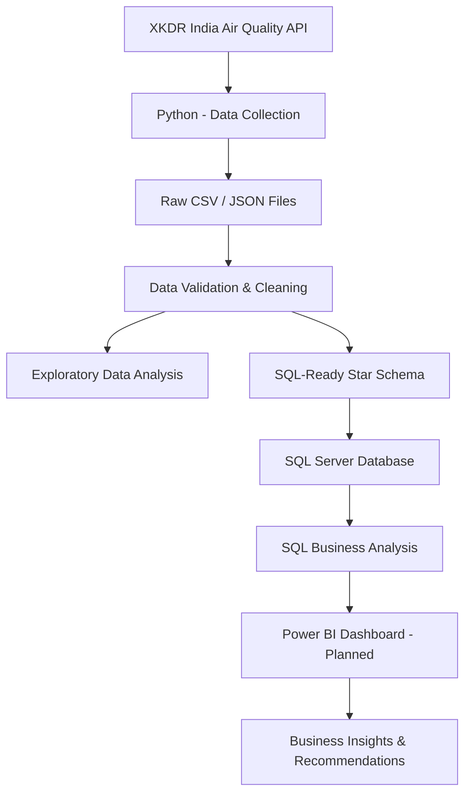
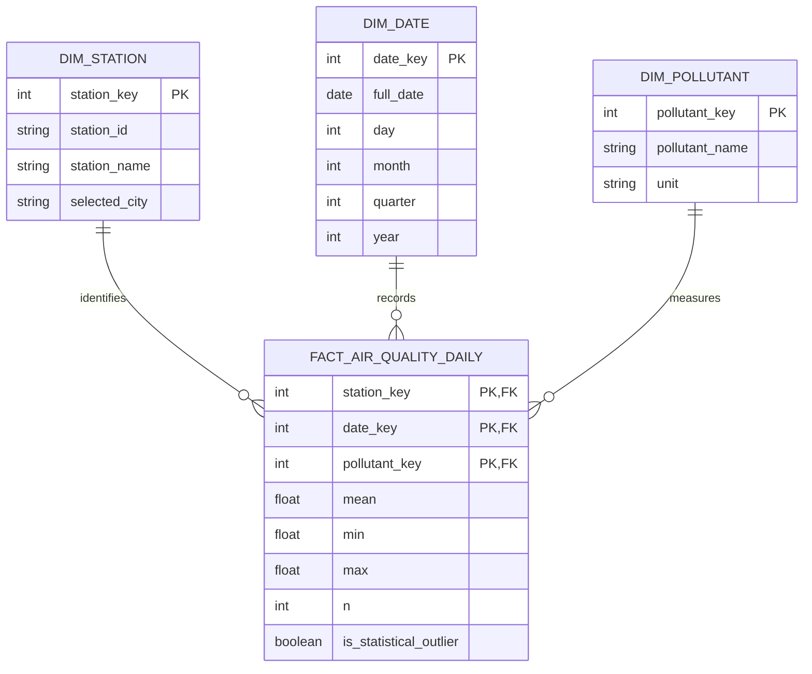

# 🌍 AirScope — Urban Air Quality & Pollution Intelligence

### An End-to-End Data Analytics Project | Python • SQL Server • Power BI

<p align="left">
  
  
  
  
</p>

**AirScope** is an end-to-end data analytics project that explores urban air pollution across six major Indian cities using historical PM2.5 and PM10 measurements collected from air-quality monitoring stations.

The project uses Python for API-based data collection, data cleaning and exploratory data analysis, and SQL Server for structured data storage, validation and business analysis. An interactive Power BI dashboard is planned as the next stage.

The objective is to transform raw environmental measurements into meaningful insights by comparing cities, analysing historical trends and identifying monitoring station hotspots.

---

## 📌 Table of Contents

- [Project Overview](#-project-overview)
- [Business Objectives](#-business-objectives)
- [Business Questions](#-business-questions)
- [Cities Covered](#-cities-covered)
- [Data Source](#-data-source)
- [Technology Stack](#-technology-stack)
- [Project Architecture](#-project-architecture)
- [Project Workflow](#-project-workflow)
- [Dataset Overview](#-dataset-overview)
- [Data Cleaning and Quality Checks](#-data-cleaning-and-quality-checks)
- [Database Design](#-database-design)
- [SQL Business Analysis](#-sql-business-analysis)
- [Key Findings](#-key-findings)
- [Project Structure](#-project-structure)
- [How to Run the Project](#-how-to-run-the-project)
- [Limitations](#-limitations)
- [Future Improvements](#-future-improvements)
- [Skills Demonstrated](#-skills-demonstrated)

---

## 📖 Project Overview

Air pollution is an important environmental concern in Indian cities. However, analysing individual pollution readings does not provide a complete picture of how pollution varies across locations and over time.

AirScope addresses this by analysing historical daily pollutant concentrations from monitoring stations across six Indian cities.

The project covers a three-year period:

**January 2022 – December 2024**

It focuses on two major air pollutants:

| Pollutant | Description |
|---|---|
| PM2.5 | Fine particulate matter with a diameter of 2.5 micrometres or smaller |
| PM10 | Particulate matter with a diameter of 10 micrometres or smaller |

Measurements are analysed in **µg/m³ (micrograms per cubic metre)**.

> **Note:** AirScope analyses measured PM2.5 and PM10 concentrations. It does not directly calculate or report official Air Quality Index (AQI) values.

---

## 🎯 Business Objectives

The project aims to:

1. Collect historical air-quality measurements through an API.
2. Explore monitoring station and pollutant availability.
3. Clean, validate and prepare the collected data.
4. Perform exploratory data analysis using Python.
5. Build a structured relational database using SQL Server.
6. Compare average pollutant concentrations across cities.
7. Analyse year-wise pollution trends from 2022 to 2024.
8. Identify monitoring stations with relatively high pollutant concentrations.
9. Develop an interactive Power BI dashboard.
10. Present findings and evidence-based recommendations.

---

## ❓ Business Questions

The SQL analysis focuses on three major business questions.

| No. | Business Question | Analytical Objective |
|---|---|---|
| 01 | Which cities have the highest average PM2.5 and PM10 concentrations? | City-wise comparison and ranking |
| 02 | How did pollutant concentrations change between 2022 and 2024? | Historical trend analysis |
| 03 | Which monitoring stations recorded the highest average pollution concentrations? | Station-level hotspot identification |

---

## 🏙️ Cities Covered

The project includes six Indian cities and 109 selected candidate monitoring stations.

| City | Candidate Stations |
|---|---:|
| Delhi | 39 |
| Mumbai | 35 |
| Hyderabad | 13 |
| Bengaluru | 12 |
| Jaipur | 6 |
| Gurugram | 4 |
| **Total** | **109** |

Station selection considered city location, PM2.5 and PM10 availability, and historical station coverage.

The selected stations do not necessarily report measurements for every day of the study period. Actual coverage varies by station and pollutant.

---

## 🌐 Data Source

**XKDR India Air Quality API**

API Base URL: https://airquality.xkdr.org/v1

The API provides monitoring station information, pollutant metadata and historical air-quality measurements.

| Endpoint | Purpose |
|---|---|
| `/meta` | Explore available dataset metadata |
| `/stations` | Retrieve monitoring station information |
| `/parameters` | Retrieve available pollutants and parameters |
| `/measurements` | Retrieve air-quality measurements |

The measurement data includes fields such as:

- `station_id`
- `parameter_name`
- `unit`
- `period_start`
- `mean`
- `min`
- `max`
- `n`

The API provides daily aggregated measurement information used in the analysis.

**Data security:** API authentication credentials are kept private and must not be committed to the public repository.

---

## 🛠️ Technology Stack

| Technology | Application |
|---|---|
| Python 3.12 | Data collection and processing |
| Requests | API communication |
| Pandas | Data cleaning, transformation and analysis |
| NumPy | Numerical operations |
| Matplotlib | Exploratory data visualisation |
| SQL Server | Relational database |
| SQL Server Management Studio (SSMS) | Database management and SQL queries |
| pyodbc | Python–SQL Server connectivity |
| Power BI | Interactive dashboard — planned |
| Git & GitHub | Version control and project documentation |

---

## 🔄 Project Architecture



---

## ⚙️ Project Workflow

### Phase 1 — API Exploration and Data Collection

**Objective:** Understand the data source and retrieve air-quality measurements.

Activities:

- Tested API connectivity and authentication.
- Inspected station and pollutant metadata.
- Analysed city-wise station coverage.
- Selected 109 candidate stations.
- Tested measurement extraction using a January 2024 pilot.
- Expanded the extraction to the full historical period.

### Phase 2 — Historical Data Extraction

**Objective:** Collect historical measurements from January 2022 to December 2024.

The extraction process divided the historical period into 36 monthly intervals and processed station-month requests.

| Extraction Status | Tasks |
|---|---:|
| Successful | 3,451 |
| No data returned | 473 |
| Failed | 0 |
| **Total tasks** | **3,924** |

**Total records collected: 198,259**

Checkpointing, extraction logs and retry handling were used to make the long-running extraction process more manageable.

### Phase 3 — Data Validation and Cleaning

**Objective:** Ensure that the collected historical data was suitable for analysis.

Checks included:

- Missing required values
- Duplicate measurements
- Invalid dates
- Negative pollutant concentrations
- Invalid observation counts
- Invalid measurement ranges
- Statistical outliers

The final historical cleaning process retained all 198,259 records.

A total of 11,278 statistical outliers were flagged using the IQR method and retained for investigation rather than automatically deleted.

### Phase 4 — Exploratory Data Analysis (EDA)

**Objective:** Understand the dataset and identify initial patterns.

Analysis included:

- City-wise pollutant averages
- Station-wise pollutant averages
- Daily concentration patterns
- Pollutant comparisons
- Station rankings
- Statistical outlier analysis
- Historical coverage analysis

Python and Matplotlib were used to generate summary tables and exploratory visualisations.

### Phase 5 — SQL-Ready Data Preparation

**Objective:** Convert the cleaned historical dataset into a structured relational model.

A star schema was prepared with:

- One fact table
- Three dimension tables

The export process performed 12 validation checks, all of which passed.

### Phase 6 — SQL Server Implementation

**Objective:** Store and validate the prepared data in SQL Server.

Activities:

- Created the AirScope database.
- Created the fact and dimension tables.
- Defined primary and foreign keys.
- Imported the CSV files using Python and pyodbc.
- Verified imported record counts.
- Performed SQL-based data validation and profiling.

All four database tables were successfully imported and verified.

### Phase 7 — SQL Business Analysis

**Objective:** Answer the three business questions using SQL.

The analysis used:

- INNER JOIN
- GROUP BY
- Aggregate functions
- Common Table Expressions (CTEs)
- DENSE_RANK()
- FIRST_VALUE()
- PARTITION BY
- Percentage calculations

---

## 📊 Dataset Overview

The final historical dataset contains:

| Metric | Value |
|---|---:|
| Historical period | 2022–2024 |
| Cities | 6 |
| Candidate monitoring stations | 109 |
| Total measurement records | 198,259 |
| PM2.5 records | 99,393 |
| PM10 records | 98,866 |
| Unique calendar dates | 1,096 |
| Statistical outlier flags | 11,278 |

### Year-wise Record Distribution

| Year | Records |
|---|---:|
| 2022 | 58,329 |
| 2023 | 66,633 |
| 2024 | 73,297 |
| **Total** | **198,259** |

### Pollutant Distribution

| Pollutant | Records |
|---|---:|
| PM2.5 | 99,393 |
| PM10 | 98,866 |
| **Total** | **198,259** |

---

## 🧹 Data Cleaning and Quality Checks

Data quality was reviewed at multiple stages rather than relying on a single cleaning operation.

### Final Historical Cleaning Results

| Validation Check | Result |
|---|---:|
| Original records | 198,259 |
| Cleaned records | 198,259 |
| Excluded records | 0 |
| Missing required values | 0 |
| Duplicate records | 0 |
| Invalid dates | 0 |
| Negative measurements | 0 |
| Invalid observation counts | 0 |
| Invalid measurement ranges | 0 |
| Statistical outliers flagged | 11,278 |

**All 8 final cleaning validations passed.**

### Outlier Handling

The Interquartile Range (IQR) method was used to flag statistically unusual values.

Outliers were retained because a statistically unusual reading is not automatically an incorrect measurement.

Some maximum readings close to 1,000 µg/m³ require additional investigation before their validity can be established.

---

## 🗄️ Database Design

AirScope uses a **Star Schema** in SQL Server.

### Database: `AirScope`



### Database Tables

| Table | Description | Records |
|---|---|---:|
| `fact_air_quality_daily` | Daily station-level pollutant measurements | 198,259 |
| `dim_station` | Monitoring station details | 109 |
| `dim_date` | Calendar and date attributes | 1,096 |
| `dim_pollutant` | Pollutant names and units | 2 |

### Fact Table Grain

One record represents:

**One monitoring station × One date × One pollutant**

A composite primary key prevents duplicate combinations.

### SQL Server Import Validation

| Table | Expected Rows | Imported Rows | Status |
|---|---:|---:|---|
| dim_station | 109 | 109 | PASS |
| dim_date | 1,096 | 1,096 | PASS |
| dim_pollutant | 2 | 2 | PASS |
| fact_air_quality_daily | 198,259 | 198,259 | PASS |

All imported table counts matched the expected counts.

---

## 🔍 SQL Business Analysis

### 1. City-wise Pollution Comparison

**Business Question:** Which cities have the highest average PM2.5 and PM10 concentrations?

The fact table was joined with station and pollutant dimensions. Average concentrations were calculated for each city and pollutant, and cities were ranked using `DENSE_RANK()`.

#### Results

| Rank | City | PM10 (µg/m³) | PM2.5 (µg/m³) |
|---:|---|---:|---:|
| 1 | Delhi | 211.12 | 101.75 |
| 2 | Gurugram | 188.22 | 92.86 |
| 3 | Jaipur | 128.41 | 56.37 |
| 4 | Mumbai | 106.49 | 43.84 |
| 5 | Hyderabad | 78.75 | 34.52 |
| 6 | Bengaluru | 72.74 | 33.83 |

**Key Insights**

- Delhi recorded the highest average PM10 and PM2.5 concentrations.
- Gurugram ranked second for both pollutants.
- Jaipur ranked third.
- Bengaluru recorded the lowest averages among the six selected cities.

**Business Implication:** Delhi and Gurugram should be prioritised for further investigation, with station-level coverage considered before drawing wider conclusions.

### 2. Historical Pollution Trend Analysis

**Business Question:** How did average PM2.5 and PM10 concentrations change between 2022 and 2024?

Year-wise averages were calculated using SQL aggregation. `FIRST_VALUE()` was used to obtain the 2022 baseline for each pollutant, and percentage changes were calculated.

#### Year-wise Results

| Year | PM10 (µg/m³) | PM2.5 (µg/m³) |
|---|---:|---:|
| 2022 | 158.23 | 72.17 |
| 2023 | 146.12 | 69.41 |
| 2024 | 138.49 | 63.87 |

#### Percentage Change: 2022–2024

| Pollutant | Percentage Change |
|---|---:|
| PM10 | -12.48% |
| PM2.5 | -11.50% |

**Key Insights**

- PM10 average concentration decreased in each year.
- PM2.5 average concentration also decreased in each year.
- Both pollutants showed a downward trend in the available dataset.

**Important Limitation**

Monitoring coverage changed between years:

| Year | PM10 Stations | PM2.5 Stations |
|---|---:|---:|
| 2022 | 89 | 90 |
| 2023 | 107 | 108 |
| 2024 | 107 | 107 |

Because the number and mix of reporting stations changed, the pooled yearly averages may reflect both concentration changes and coverage changes.

A consistent-station comparison is needed before making stronger claims about long-term improvement.

### 3. Monitoring Station Hotspot Analysis

**Business Question:** Which monitoring stations recorded the highest average pollutant concentrations?

Station-level averages were calculated, and `DENSE_RANK()` was used to identify the top ten stations separately for PM10 and PM2.5.

#### Top 10 PM10 Stations

| Rank | Monitoring Station | City | Average PM10 |
|---:|---|---|---:|
| 1 | Anand Vihar | Delhi | 310.01 |
| 2 | Mundka | Delhi | 276.18 |
| 3 | Jahangirpuri | Delhi | 269.75 |
| 4 | Vikas Sadan | Gurugram | 263.00 |
| 5 | Wazirpur | Delhi | 260.20 |
| 6 | Dwarka Sector 8 | Delhi | 246.59 |
| 7 | Bawana | Delhi | 242.73 |
| 8 | Shadipur | Delhi | 241.37 |
| 9 | Rohini | Delhi | 235.40 |
| 10 | Vivek Vihar | Delhi | 234.75 |

#### Top 10 PM2.5 Stations

| Rank | Monitoring Station | City | Average PM2.5 |
|---:|---|---|---:|
| 1 | Anand Vihar | Delhi | 129.20 |
| 2 | Jahangirpuri | Delhi | 127.05 |
| 3 | Wazirpur | Delhi | 120.85 |
| 4 | Bawana | Delhi | 120.48 |
| 5 | Mundka | Delhi | 120.00 |
| 6 | Nehru Nagar | Delhi | 119.33 |
| 7 | Punjabi Bagh | Delhi | 117.41 |
| 8 | R K Puram | Delhi | 114.55 |
| 9 | Rohini | Delhi | 113.84 |
| 10 | Shadipur | Delhi | 112.26 |

All concentrations are in µg/m³.

**Key Insights**

- Anand Vihar ranked first for both PM10 and PM2.5.
- Nine of the top ten PM10 stations were located in Delhi.
- All ten top PM2.5 stations were located in Delhi.
- Several locations appeared in both pollutant rankings.

**Coverage Consideration:** Vikas Sadan in Gurugram had only 15 PM10 measurements, compared with around 1,000 for most other stations in the ranking. Its average requires further investigation before direct comparison.

**Business Implication:** Locations repeatedly appearing in both rankings should be prioritised for further investigation. These rankings identify relative hotspots in the available dataset, not official pollution classifications or confirmed pollution sources.

---

## 💡 Overall Key Findings

1. Delhi recorded the highest pooled average PM2.5 and PM10 concentrations among the six selected cities.
2. Gurugram ranked second for both pollutants.
3. Both pollutant averages decreased between 2022 and 2024 in the available dataset.
4. Anand Vihar in Delhi ranked highest for both pollutants in the station-level analysis.
5. Station reporting coverage is an important consideration when interpreting city and historical comparisons.

---

## 📁 Project Structure

```text
AirScope/
│
├── Dataset/
│   ├── Raw/
│   │   ├── Historical_2022_2024/
│   │   ├── stations.json
│   │   ├── parameters.json
│   │   └── ...
│   │
│   ├── Cleaned/
│   │   ├── Historical_Final/
│   │   │   ├── airscope_historical_2022_2024_cleaned.csv
│   │   │   ├── invalid_records_review.csv
│   │   │   ├── duplicate_records_review.csv
│   │   │   ├── statistical_outlier_review.csv
│   │   │   ├── historical_cleaning_quality_report.csv
│   │   │   └── SQL_Ready/
│   │   │       ├── fact_air_quality_daily.csv
│   │   │       ├── dim_station.csv
│   │   │       ├── dim_date.csv
│   │   │       └── dim_pollutant.csv
│   │   └── ...
│   │
│   └── Reference/
│
├── Python/
│   ├── 01_api_connection_test.py
│   ├── 02_metadata_inspection.py
│   ├── ...
│   ├── 15_historical_data_extraction.py
│   ├── 16_historical_pilot_validation.py
│   ├── 17_historical_coverage_analysis.py
│   ├── 18_combine_historical_data.py
│   ├── 19_historical_data_cleaning.py
│   └── 20_historical_sql_ready_export.py
│
├── SQL/
│   ├── 01_city_wise_pollution_comparison.sql
│   ├── 02_year_wise_pollution_trend.sql
│   ├── 03_station_wise_pollution_hotspots.sql
│   └── ...
│
├── PowerBI/
│   └── (Dashboard files — planned)
│
├── Documentation/
│   └── AirScope_Project_Documentation.docx
│
└── README.md
```

*Note: The structure above is the intended repository organisation. Update script and SQL filenames to match the actual files committed to GitHub.*

---

## 🚀 How to Run the Project

### 1. Clone the Repository

```bash
git clone <YOUR_GITHUB_REPOSITORY_URL>
cd AirScope
```

### 2. Install Dependencies

```bash
pip install pandas numpy requests matplotlib pyodbc
```

### 3. Configure API Authentication

Obtain the required API access credentials and configure them securely.

Do not put API keys directly in Python source files or commit them to GitHub.

For example, use an environment variable:

```python
import os

API_KEY = os.getenv("XKDR_API_KEY")

if not API_KEY:
    raise ValueError("API key is not configured.")
```

### 4. Run Python Scripts

Run the scripts in the required sequence, beginning with API connection and metadata exploration, followed by data extraction, validation, cleaning and SQL-ready export.

The historical extraction process may take time because it processes multiple stations and months. Its checkpoint and log files should be preserved when resuming.

### 5. Set Up SQL Server

- Install SQL Server and SQL Server Management Studio.
- Create the AirScope database.
- Execute the SQL table creation scripts.
- Configure the Python ODBC connection.
- Import the prepared dimension and fact CSV files.
- Run the validation and business analysis queries.

**Important:** Update database connection settings and local file paths for your own environment. Do not commit private credentials.

---

## ⚠️ Limitations

- Monitoring station coverage is unequal across cities.
- Not every station reports both pollutants every day.
- Reporting station counts and the mix of stations change over time.
- Averages are calculated from available daily station means and are not population-weighted.
- Statistical outliers are retained and require contextual review.
- Some maximum readings close to 1,000 µg/m³ need further investigation.
- The project analyses PM2.5 and PM10 concentrations, not official AQI values.
- The analysis identifies patterns and locations for further investigation; it does not independently establish pollution causes.

---

## 🔮 Future Improvements

- Build an interactive Power BI dashboard with KPI cards, city comparisons, historical trends and hotspot analysis.
- Add a consistent-station comparison for 2022–2024.
- Perform seasonal and monthly pollution analysis.
- Investigate unusually high measurements and possible sensor/reporting limits.
- Add more cities and monitoring stations where data coverage supports reliable comparisons.
- Explore official AQI calculation separately using the applicable methodology and required inputs.
- Improve automated data refresh and reporting.

---

## 🧠 Skills Demonstrated

**Python & Data Processing**
- API integration
- Data extraction automation
- Pandas data manipulation
- Data cleaning and validation
- Exploratory Data Analysis
- Outlier investigation
- Data visualisation

**SQL & Database Management**
- Relational database design
- Star schema
- Primary and foreign keys
- SQL joins and aggregations
- Common Table Expressions
- Window functions
- Ranking and trend analysis
- Database validation

**Business & Analytical Skills**
- Business question formulation
- KPI and metric analysis
- City-wise comparison
- Historical trend interpretation
- Hotspot identification
- Data-quality assessment
- Evidence-based recommendations

---

## 👨‍💻 Author

**Karamveer Singh**

Computer Science Graduate | Aspiring Data Analyst

- **LinkedIn:** https://www.linkedin.com/in/kar4mveer/
- **GitHub:** https://www.github.com/kar4mveer/

---

## ⭐ If You Find This Project Interesting

Feel free to explore the repository, review the analysis and share suggestions for improvement.

**AirScope — Turning air-quality data into meaningful insights.**
